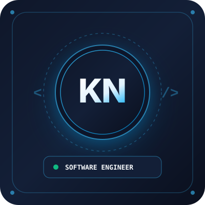

# My Personal Portfolio — KEMA NEERAJA 🌟

> **A modern, responsive, and professional portfolio website created for the InAmigos Foundation Internship Task.**



---

## 👩‍💻 About KEMA NEERAJA
- **Role:** B.E Student | Aspiring Software Developer | Technology Enthusiast
- **Education:** 3rd Year Bachelor of Engineering (B.E) in **Computer Science & Engineering (AI & ML)**
- **College:** Keshav Memorial Engineering College (KMEC), Hyderabad
- **Email:** [neerunetha@gmail.com](mailto:neerunetha@gmail.com)
- **LinkedIn:** [linkedin.com/in/kema-neeraja-518839381](https://www.linkedin.com/in/kema-neeraja-518839381?utm_source=share_via&utm_content=profile&utm_medium=member_android)
- **GitHub:** [github.com/neerunetha-04](https://github.com/neerunetha-04)

---

## ✨ Features & Highlights

1. **Clean & Professional Dark Navy Theme:**
   - Palette: Dark Navy Blue (`#0a0f1d`, `#131f37`), crisp white typography, and vibrant light blue accents (`#38bdf8`).
   - Modern glassmorphism header, smooth gradients, and subtle glow effects without clutter.

2. **100% Responsive Design:**
   - Seamlessly adapts across mobile phones, tablets, laptops, and ultra-wide desktops.
   - Smooth animated mobile drawer menu with hamburger toggle.

3. **Complete Section Structure:**
   - **Home (Hero):** Name prominently displayed, professional headline, introductory bio, profile avatar placeholder, and quick action buttons.
   - **About Me:** Highlights academic focus in AI/ML, problem-solving mindset, creativity, and teamwork strengths.
   - **Skills:** Categorized into Programming (*Python*), Web Development (*HTML, CSS, JavaScript*), Technical Skills (*Problem Solving, Databases*), Tools (*GitHub, Colab, MS Office*), and Soft Skills.
   - **Education:** Structured academic timeline showcasing current B.E (AI & ML) at Keshav Memorial Engineering College, plus editable senior secondary milestones.
   - **Projects & Learning:** Real-world student project cards with tags, descriptions, GitHub links, and learning takeaways.
   - **Contact:** One-click email copy button, LinkedIn & GitHub quick links, and a functional validated contact form.
   - **Footer:** Copyright notice, fast navigation links, and InAmigos Foundation task recognition.

4. **Zero Build Dependencies:**
   - Built with pure HTML5, CSS3, and vanilla JavaScript.
   - No npm install, no bundlers, no build step required. Double click `index.html` and it works instantly!

---

## 📂 Project Structure

```
profile/
├── index.html        # Main HTML structure with semantic sections
├── style.css         # Modern CSS styles, variables, responsive breakpoints
├── script.js         # Mobile navbar, scroll animations, form validator, copy email
├── assets/
│   ├── avatar.svg    # Sleek vector tech avatar placeholder
│   └── favicon.svg   # Custom monogram browser tab icon ("KN")
└── README.md         # Documentation & deployment guide
```

---

## 🚀 How to Run Locally

You can run this website on your computer in multiple ways:

### Option 1: Direct Double Click (Easiest)
1. Open File Explorer to `c:\Users\ynmne_rou70pp\OneDrive\Desktop\profile`.
2. Double-click **`index.html`**.
3. It will open immediately in your default browser (Chrome, Edge, Firefox, Brave).

### Option 2: Using Python Simple Server (Recommended for testing)
Open PowerShell in this folder and run:
```powershell
python -m http.server 3000
```
Then visit `http://localhost:3000` in your web browser.

---

## ✏️ How to Personalize & Edit

Every section has been carefully documented with HTML comments so you can easily customize it:

### 1. Adding Your Real Profile Photo
1. Save your photograph (e.g. `profile.jpg` or `profile.png`) into the `assets/` folder.
2. Open `index.html` in VS Code or any text editor.
3. Locate line ~145:
   ```html
   
   ```
4. Change `assets/avatar.svg` to `assets/profile.jpg`. Save the file and refresh!

### 2. Updating Intermediate / High School Details
- In `index.html`, find the `<section id="education">` section.
- Replace `[Junior College / Intermediate Institution]` and `[High School Name]` with your actual school names.

### 3. Adding More Projects or Editing Skills
- In `<section id="skills">`, duplicate any `.skill-item` block to add more skills or adjust the percentage bars (`style="width: 85%;"`).
- In `<section id="projects">`, duplicate any `.project-card` to showcase more academic assignments or hackathons.

---

## 🌐 How to Publish Live (For InAmigos Foundation Submission)

To submit a live website link for your internship task, deploy it for free using **GitHub Pages**:

### Step 1: Initialize Git & Push to GitHub
Open PowerShell inside `profile/`:
```powershell
git init
git add .
git commit -m "Initial commit: Kema Neeraja Personal Portfolio for InAmigos Foundation"
git branch -M main
```

Create a new repository on your GitHub account (`https://github.com/new`) named **`portfolio`** (or **`neerunetha-04.github.io`**).

Then link and push:
```powershell
git remote add origin https://github.com/neerunetha-04/portfolio.git
git push -u origin main
```

### Step 2: Enable GitHub Pages
1. Go to your repository on GitHub: `https://github.com/neerunetha-04/portfolio`.
2. Click **Settings** (top right tab).
3. In the left sidebar, click **Pages**.
4. Under **Branch**, select `main` and `/ (root)`. Click **Save**.
5. Within 1-2 minutes, GitHub will generate your live URL:
   ```
   https://neerunetha-04.github.io/portfolio/
   ```

### Step 3: Alternative Instant Deployment (Netlify Drop)
1. Go to [app.netlify.com/drop](https://app.netlify.com/drop).
2. Drag and drop the `profile` folder into the browser.
3. In 10 seconds, Netlify will give you a live HTTPS link!

---

## 📄 License & Credits
- **Author:** Kema Neeraja
- **Internship:** InAmigos Foundation Task
- **Year:** 2026
